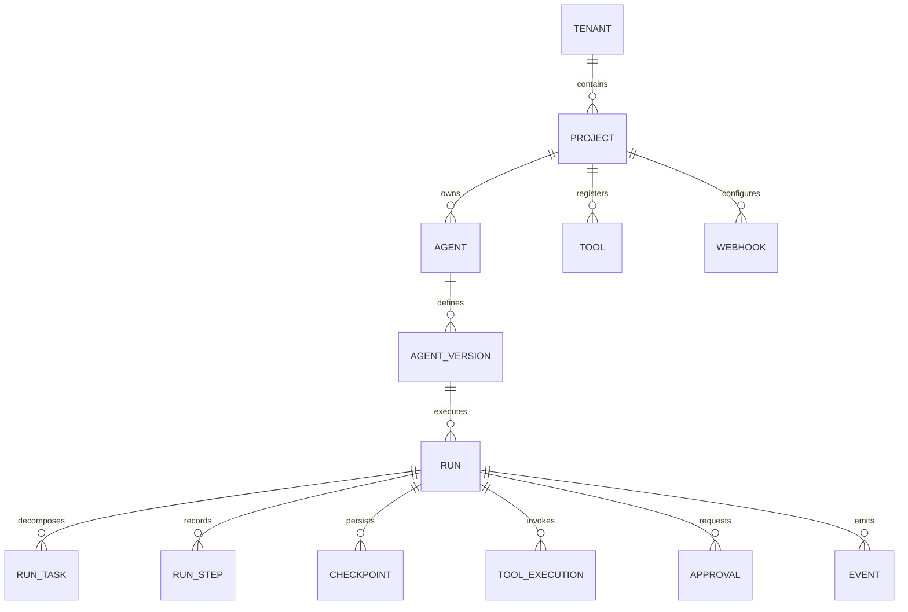
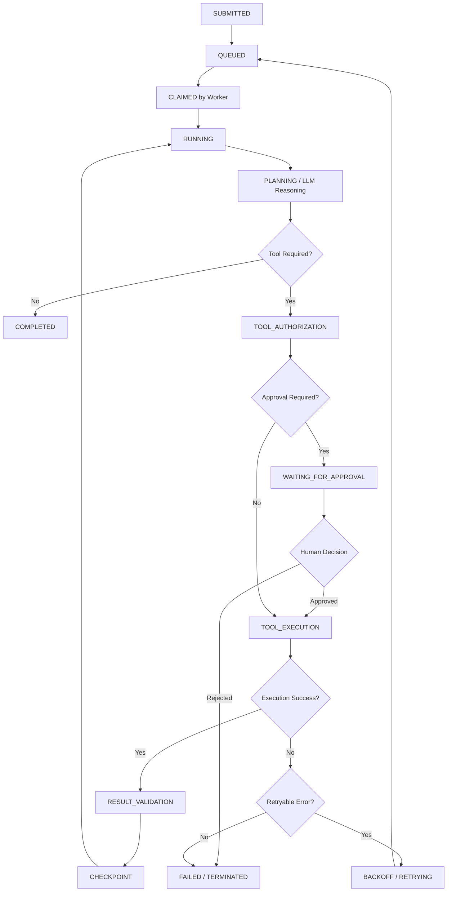
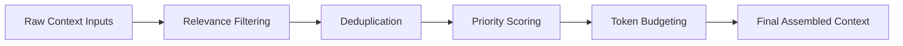
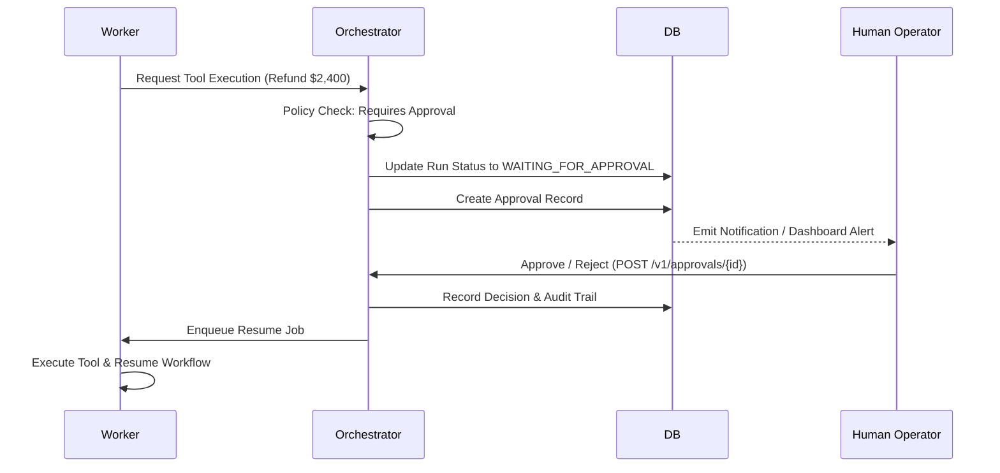
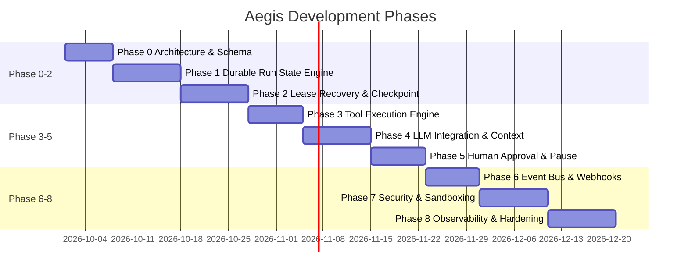

# Aegis: Durable AI Agent Execution Runtime
## Complete Master Architecture & Technical Specification

---

### 1. Executive Summary

**Aegis** is a production-oriented, durable AI agent runtime designed to execute long-running, multi-step AI tasks reliably.

> **Core Philosophy:** A language model is not an execution engine.

A normal LLM application can send a prompt, receive a response, call a tool, and return an answer. That architecture becomes inadequate when an agent must execute many steps, survive worker crashes, wait for external systems, retry failed operations, request human approval, maintain state, execute tools securely, emit events, or resume work hours later.

Aegis provides that missing execution layer.

Aegis is therefore not a chatbot, agent demo, prompt wrapper, or collection of tool-calling functions. It is a **durable execution platform** for AI agents and business workflows.

The project is intended to become one of the two flagship AI-engineering systems on **arslanrehmani.com**, alongside **Atlas**.

---

### 2. Portfolio Role

Aegis answers this central engineering question:

> *Can Arslan build the runtime infrastructure required for AI agents to perform real work reliably?*

The existing portfolio demonstrates business applications such as manufacturing operations, e-commerce, market intelligence, and legal intelligence. Aegis adds the core infrastructure layer.

#### Portfolio Architecture Hierarchy
```
Business Applications
        ↓
AI Applications
        ↓
AI Agent Runtime (Aegis)
        ↓
Reliable Business Automation
```

#### Demonstrated Technical Depth
Aegis demonstrates deep engineering expertise in:
- **Distributed Systems & Async Execution**: Task queues, event-driven state machines, worker lease models, heartbeats.
- **Resilience & Reliability**: Durable workflows, incremental checkpoints, exponential backoff retries, idempotency, dead-letter queues (DLQ).
- **Concurrency & Resource Management**: Multi-tenant limits, backpressure controls, rate limiting, graceful shutdown semantics.
- **Security & Tool Sandboxing**: Granular permission hierarchies, isolated containerized execution, SSRF protection.
- **Context & Human-in-the-Loop**: Dynamic context assembly, token budgeting, approval gates, pause/resume primitives.
- **Observability & Auditability**: Distributed event streaming, signed webhooks, structured JSON logging, trace correlation IDs.

---

### 3. Problem Statement

A naive agent architecture relies on simple synchronous request/response loops:

```
User ──► LLM ──► Tool ──► LLM ──► Answer
```

This breaks under real-world operational requirements.

Consider an agent that must:
1. Inspect a Shopify order.
2. Retrieve inventory from an internal ERP.
3. Contact a supplier via API.
4. Wait for an external webhook response.
5. Calculate a reorder recommendation.
6. Ask a human for approval on high-value orders.
7. Update the ERP upon approval.
8. Send vendor and customer emails.
9. Emit status webhooks.
10. Record a complete immutable audit trail.

A single HTTP request is not an appropriate execution model for this.

#### Key Failures Handled by Aegis
- **Long-Running Tasks**: Tasks that span minutes, hours, or days.
- **Process & Worker Crashes**: Sudden worker host terminates mid-step.
- **Provider Failures**: LLM API rate limits, timeouts, or 50x errors.
- **Tool Failures & Side-Effects**: Downstream API failures and partial updates.
- **Duplicate Delivery**: Network retries causing double execution of side-effects.
- **State Persistence**: Loss of in-memory context across server restarts.
- **Human Approval Pauses**: Halting execution safely for human sign-off.
- **Concurrency & Resource Limits**: Unbounded task execution overloading downstream databases.

---

### 4. Core Design Principle

**Aegis must treat an agent run as a durable stateful process, not as a request/response cycle.**

The system must be able to answer at any point:
- *What is this run doing right now?*
- *What has already happened in preceding steps?*
- *What was the last successful checkpoint?*
- *Which tool is executing and under what input arguments?*
- *What happens if the worker dies right now?*
- *Can the run safely resume without repeating side effects?*
- *Has an external side effect (e.g., payment, email, DB write) already been committed?*
- *Is human approval required before proceeding?*
- *What events have been emitted to external subscribers?*
- *Why did the run fail, and can an operator replay or resume it?*

---

### 5. Goals

#### 5.1 Primary Goals
Aegis must provide:
- **Durable Agent Execution**: State machine-backed runs capable of surviving process crashes.
- **Asynchronous Task Execution**: Background job processing via distributed message queues.
- **Persistent Run State**: Full step history and variables stored in durable storage.
- **Incremental Checkpointing**: State snapshots saved after every valid transition.
- **Automated Retry & Recovery**: Intelligent retry policies with safe crash recovery.
- **Tool Registry & Execution Engine**: Versioned tool schemas with structured execution.
- **Granular Tool Permissions**: Multi-level authorization policies for tool invocations.
- **Sandboxed Execution**: Isolated container/process environments for executing untrusted tools.
- **Context Assembly Engine**: Dynamic token-budgeted prompt construction with relevance filtering.
- **Human Approval Gates**: Native execution pause and resume capabilities.
- **Event & Webhook Delivery**: Reliable, signed webhook dispatch with retries and DLQ.
- **Scheduling**: Time-delayed and recurring run execution.
- **Cancellation & Timeouts**: Clean cooperative cancellation and execution timeout limits.
- **Idempotency Controls**: Guaranteed single-execution semantics for external side-effects.
- **Audit Logs & Structured Observability**: OpenTelemetry tracing, metrics, and correlation IDs.
- **Multi-Tenant Isolation**: Strict logical data and execution boundaries per tenant.

#### 5.2 Secondary Goals
Aegis should also demonstrate:
- Horizontal worker scaling with dynamic lease distribution.
- Backpressure and global/tenant rate limiting.
- Dead-letter queues (DLQ) with operator replay controls.
- Graceful shutdown handlers ensuring in-flight step completion or clean checkpointing.
- Workflow replay and deterministic execution tracing.
- Versioned agent definitions and versioned tool definitions.

---

### 6. Non-Goals

Aegis is intentionally focused on runtime infrastructure. It is **not** intended to become:
- A general-purpose LLM API provider or proxy wrapper.
- A consumer-facing chatbot application.
- A generic CRM or ERP business software system.
- A standalone vector database engine.
- A Kubernetes orchestration replacement.
- A browser automation product.
- A model-training or fine-tuning platform.
- An unrestricted multi-tenant code-execution service (PaaS).

*Aegis integrates with these systems where useful, but they are not the product.*

---

### 7. Target Users

#### 7.1 Application Developers
Developers who need to define agents and submit runs without implementing custom queueing, retries, checkpointing, or execution state machines.

#### 7.2 AI Product Teams
Product engineering teams requiring production operational features: distributed queues, rate limits, authorization policies, approval workflows, and trace observability.

#### 7.3 Operational Businesses
Enterprises deploying background automation for workflows such as inventory monitoring, order investigation, customer support escalation, supplier follow-up, financial reconciliation, and document processing.

---

### 8. Conceptual Model



---

### 9. Core Domain Objects

#### 9.1 Tenant
Represents an isolated customer or organization.
- `id`: UUID (Primary Key)
- `name`: String
- `status`: Enum (`ACTIVE`, `SUSPENDED`, `DELETED`)
- `created_at`: Timestamp
- `updated_at`: Timestamp

#### 9.2 Project
Logical grouping of agents, tools, policies, and runs.
- `id`: UUID (Primary Key)
- `tenant_id`: UUID (Foreign Key)
- `name`: String
- `description`: Text
- `created_at`: Timestamp

#### 9.3 Agent
Logical agent identity.
- `id`: UUID (Primary Key)
- `project_id`: UUID (Foreign Key)
- `name`: String
- `description`: Text
- `active_version_id`: UUID (Optional Foreign Key)

#### 9.4 Agent Version
An immutable configuration snapshot defining how an agent operates.
- `id`: UUID (Primary Key)
- `agent_id`: UUID (Foreign Key)
- `version`: Integer / SemVer
- `model_config`: JSONB (provider, model name, temperature, max tokens)
- `system_instructions`: Text
- `tool_bindings`: JSONB (array of allowed tool IDs and permissions)
- `policies`: JSONB (retry limits, approval rules, timeouts)
- `context_strategy`: JSONB (history limits, retrieval settings)
- `created_at`: Timestamp
*Agent versions are strictly immutable after publication.*

#### 9.5 Run
A single execution instance of an Agent Version.
- `id`: UUID (Primary Key)
- `agent_version_id`: UUID (Foreign Key)
- `status`: Enum
- `input`: JSONB
- `output`: JSONB (Optional)
- `started_at`: Timestamp (Optional)
- `completed_at`: Timestamp (Optional)
- `failure_reason`: Text (Optional)

##### Run Status States
`QUEUED` | `RUNNING` | `WAITING_FOR_TOOL` | `WAITING_FOR_APPROVAL` | `PAUSED` | `RETRYING` | `COMPLETED` | `FAILED` | `CANCELLED` | `TIMED_OUT`

---

### 10. Execution Lifecycle



---

### 11. System Architecture

```
                        CLIENTS
                           │
                           ▼
                    ┌─────────────┐
                    │ API Gateway │
                    └──────┬──────┘
                           │
              ┌────────────┼────────────┐
              ▼            ▼            ▼
          Run API      Agent API     Tool API
              │
              ▼
       ┌─────────────────┐
       │ Orchestrator    │
       └────────┬────────┘
                │
        ┌───────┴────────┐
        ▼                ▼
   PostgreSQL         Redis/Queue
        │                │
        │         ┌──────┴──────┐
        │         ▼             ▼
        │      Worker 1      Worker N
        │         │             │
        │         └──────┬──────┘
        │                ▼
        │        Agent Executor
        │                │
        │      ┌─────────┼─────────┐
        │      ▼         ▼         ▼
        │   Context    Tools    Policies
        │      │         │
        │      ▼         ▼
        │   Retrieval  Sandbox
        │
        └──────────────┐
                       ▼
                 Event System
                       │
             ┌─────────┴─────────┐
             ▼                   ▼
          Webhooks            Event Log
```

---

### 12. Recommended Technology Stack

| Layer | Technology | Rationale |
| :--- | :--- | :--- |
| **Language** | Python 3.12+ | Ecosystem standard for AI/LLM integrations, robust native `asyncio`, type hints. |
| **API Framework** | FastAPI + Pydantic v2 | High-performance asynchronous REST endpoints, automatic OpenAPI documentation, schema validation. |
| **Database** | PostgreSQL 16+ | ACID compliance, robust JSONB support for unstructured step payloads, relational integrity. |
| **Queue / Broker** | Redis 7+ (Streams / PubSub) | Ultra-fast message queueing, atomic lock operations for worker leasing and heartbeating. |
| **ORM & Migrations**| SQLAlchemy 2.0 + Alembic | Modern async ORM pattern, explicit migration history, raw query escape hatch. |
| **Containerization**| Docker & Docker Compose | Uniform dev/prod setup for API, Worker, PostgreSQL, Redis, and Sandbox containers. |
| **Testing** | pytest, pytest-asyncio, httpx | Async testing suite with fixtures, API test clients, and failure simulation helpers. |

---

### 13. Repository Structure

```
aegis/
├── apps/
│   ├── api/                  # FastAPI Web Application & API endpoints
│   ├── worker/               # Background task consumer loop & worker lease manager
│   └── dashboard/            # Administrative UI & run visualization interface
├── packages/
│   ├── domain/               # Pure domain entities, value objects, & state machines
│   ├── orchestration/        # Workflow orchestrator, lease renewal, checkpointing
│   ├── tools/                # Tool execution engine, registry, schema parsing
│   ├── context/              # Context assembly engine, relevance filter, token budgeter
│   ├── policies/             # Authorization, rate limits, retry rules, safety controls
│   ├── events/               # Event bus, webhook dispatcher, signed payload formatting
│   ├── storage/              # Database repositories, Redis client, blob storage adapters
│   └── observability/        # OpenTelemetry setup, JSON logger, metrics instrumentation
├── tests/
│   ├── unit/                 # Pure domain logic tests (state transitions, token counting)
│   ├── integration/          # DB/Redis repository & queue integration tests
│   ├── e2e/                  # End-to-end multi-step agent run execution tests
│   └── failure/              # Worker SIGKILL crash, DB partition, provider timeout tests
├── migrations/               # Alembic database migration scripts
├── infra/
│   ├── docker/               # Containerfiles for API, Worker, and Sandbox environments
│   └── terraform/            # Infrastructure deployment scripts
├── docs/                     # Architectural Decision Records (ADRs) & specifications
├── scripts/                  # Seed scripts, benchmarking tools, dev helpers
├── docker-compose.yml
├── pyproject.toml
├── README.md
└── LICENSE
```

---

### 14. Queue Design & Worker Lease Protocol

Aegis implements an explicit **Lease Model** to ensure tasks are never lost if a worker process crashes or loses network connection.

```
QUEUED ──► CLAIMED (Worker ID assigned + Lease TTL set) ──► HEARTBEATING ──► ACK (Completed)
   │                                                                │
   └─────────────◄───── LEASE EXPIRED (Worker lost) ────────────────┘
```

#### Job Payload Schema
Every task unit contains:
- `job_id`: Unique message ID.
- `run_id`: Associated agent run UUID.
- `task_id`: Execution task identifier.
- `priority`: Numeric priority index.
- `attempt_count`: Current execution attempt index.
- `available_at`: Timestamp when job becomes eligible for execution.
- `lease_expiration`: Expiration timestamp of the current worker lease.
- `worker_id`: Unique identifier of the handling worker process.
- `idempotency_key`: Deduplication key.

#### Worker Lease Protocol
1. Worker claims a job from Redis with an initial lease duration (e.g., 30 seconds).
2. While processing the step, worker periodically sends heartbeats to refresh `lease_expiration`.
3. If worker crashes or drops off, the lease expires.
4. A background monitor process re-queues expired jobs automatically for pickup by another worker.

---

### 15. Idempotency Architecture

Every externally visible side effect (sending an email, invoking a third-party API, updating a database record) must be strictly idempotent to prevent duplicate execution during retries.

#### Key Generation Strategy
$$\text{Idempotency Key} = \text{Hash}(\text{run\_id} + \text{step\_id} + \text{attempt\_semantic\_key})$$

#### Execution Flow
1. Prior to invoking an external side-effect tool, worker queries `tool_executions` for `idempotency_key`.
2. If record exists in status `COMPLETED`, worker skips execution and returns the saved result.
3. If record does not exist, a record is inserted in status `EXECUTING`.
4. Tool executes; upon success, result is committed alongside step state update in a single transaction.

---

### 16. State Checkpointing

Aegis creates immutable state checkpoints after every completed execution step.

```
Step 1 Completed ──► CHECKPOINT 1 ──► Step 2 Completed ──► CHECKPOINT 2 ──► Step 3 (Crash!)
                                                                                │
   Resume from CHECKPOINT 2 ◄───────────────────────────────────────────────────┘
```

#### Checkpoint Payload Contents
- `run_id`: Parent run UUID reference.
- `step_number`: Monotonically increasing step counter.
- `run_state`: Snapshot of execution variables.
- `completed_steps`: Array of completed step summaries.
- `tool_outputs_hash`: Hash/pointer to recorded tool outputs.
- `context_ref`: Pointer to assembled context history.
- `created_at`: Timestamp.

*Large data payloads are stored out-of-band in object storage / DB references to keep checkpoints lightweight and fast to read.*

---

### 17. Retry System & Backoff Policy

Distinguishes between retryable transient failures and non-retryable fatal errors.

#### Error Classification
| Error Category | Examples | Retry Strategy |
| :--- | :--- | :--- |
| **Transient Network** | Socket timeout, connection reset | Immediate retry (up to 3x) |
| **Rate Limit / 429** | Provider quota exceeded | Exponential backoff with full jitter |
| **External Dependency** | Third-party service down | Scheduled delayed retry |
| **Fatal Application** | Invalid input, schema error, permission denied | No retry ➔ Immediate Failure |

#### Exponential Backoff Formula
$$t_{\text{wait}} = \min\left(t_{\text{max}},\, t_{\text{base}} \times 2^{\text{attempt}}\right) + \text{RandomJitter}()$$

---

### 18. Dead-Letter Queue (DLQ)

Jobs that exceed maximum retry thresholds are moved to a dedicated Dead-Letter Queue.

#### Operator Actions Available
- **Inspect**: Examine full stack trace, step parameters, and environment state.
- **Retry**: Re-enqueue job after fixing underlying issue or downstream service.
- **Cancel**: Mark run as permanently failed or cancelled.
- **Edit & Resume**: Adjust job parameters or injection state before re-running.

---

### 19. Tool Registry & Schema Versioning

Every tool in Aegis must be formally registered with strict input and output JSON schemas.

```json
{
  "id": "tool-inv-01",
  "name": "get_inventory",
  "version": "1.2.0",
  "description": "Retrieve current inventory levels for a specified product SKU",
  "input_schema": {
    "type": "object",
    "properties": {
      "sku": { "type": "string", "description": "Product SKU code" },
      "warehouse_id": { "type": "string", "description": "Optional warehouse filter" }
    },
    "required": ["sku"]
  },
  "output_schema": {
    "type": "object",
    "properties": {
      "sku": { "type": "string" },
      "quantity_available": { "type": "integer" },
      "reserved": { "type": "integer" }
    }
  },
  "risk_level": "LOW",
  "requires_approval": false,
  "timeout_seconds": 15
}
```

---

### 20. Tool Permissions & Multi-Layer Authorization

Access to execute tools is evaluated against a strict multi-layered policy hierarchy:

```
Tenant Policy ──► Project Policy ──► Agent Policy ──► Tool Permission Check ──► Execution
```

- **Allowed**: Tool executes automatically.
- **Approval Required**: Step pauses and transitions run to `WAITING_FOR_APPROVAL`.
- **Prohibited**: Run halts with authorization error.

---

### 21. Sandboxed Tool Execution

For risky tools (code execution, custom script evaluation, shell commands), Aegis provides an isolated containerized execution environment.

#### Isolation Controls
- **Resource Constraints**: Hard limits on CPU (e.g., 0.5 vCPU) and RAM (e.g., 256MB).
- **Execution Timeout**: Hard kill after `timeout_seconds`.
- **Network Isolation**: Restricted outbound traffic; blocked access to internal cloud metadata endpoints.
- **Filesystem Isolation**: Ephemeral read-only root with temporary, non-persistent `/tmp` mount.
- **Process Isolation**: Unprivileged container user with dropped Linux capabilities.

---

### 22. Dynamic Context Assembly Engine

Context is managed as a finite resource constrained by model token limits.



#### Selection Mechanics
- **Relevance Filtering**: Prunes historical interactions unrelated to current step objective.
- **Deduplication**: Removes repeated system instruction blocks or duplicate tool specs.
- **Token Budget Allocation**: Allocates fixed percentages to System Prompt, Memory, Active Window, and Tool Specs.
- **Truncation Tracking**: Records exactly what was omitted with diagnostic logs.

---

### 23. Human-in-the-Loop Approval Operations

When a tool or action triggers an approval requirement (e.g., financial refund over $500), execution halts safely.



---

### 24. Event Architecture

Aegis emits immutable, structured audit events throughout the execution lifecycle.

```json
{
  "event_id": "evt-8921-bc",
  "event_type": "run.step.completed",
  "tenant_id": "ten-4410",
  "project_id": "proj-9901",
  "run_id": "run-0012",
  "timestamp": "2026-09-27T18:30:00.000Z",
  "data": {
    "step_number": 3,
    "tool_name": "get_inventory",
    "duration_ms": 142,
    "checkpoint_id": "chk-7712"
  }
}
```

---

### 25. Reliable Webhook Delivery System

External event notifications are dispatched through a reliable background delivery service.

#### Key Features
- **HMAC Signatures**: Every payload signed with standard SHA-256 HMAC headers.
- **Exponential Backoff**: Up to 5 retries over a 24-hour period.
- **Idempotency Headers**: Unique `X-Aegis-Delivery-ID` header on all dispatches.
- **Dead-Letter Handling**: Failed delivery attempts logged for operator inspection.

---

### 26. Scheduling Engine

Supports immediate, delayed, and recurring cron-style task dispatches.

- **Run Now**: Enqueued immediately for worker execution.
- **Run at Timestamp**: Scheduled in Redis sorted set until trigger time.
- **Recurring Schedule**: Cron expression managed by scheduler process which enqueues execution jobs.

*Schedulers only create run jobs; they never execute agent reasoning directly.*

---

### 27. Run Cancellation

Cancellation is handled gracefully to ensure side effects are cleanly concluded.

```
REQUESTED ──► COOPERATIVE STOP ──► CLEANUP ──► CANCELLED
```

If a tool is executing when cancellation is triggered, the worker sends cancellation signals to the underlying tool subprocess/http context before transitioning state.

---

### 28. Concurrency & Rate Limiting

Protects system resources and external API quotas using multi-tier concurrency limits.

#### Hierarchy Limits
- **Tenant Level**: Max 50 concurrent active runs.
- **Agent Level**: Max 10 concurrent runs per agent.
- **Tool Level**: Max 5 concurrent invocations for rate-sensitive APIs.
- **LLM Provider Level**: Max requests/minute limits enforced via token buckets.

---

### 29. Observability & Tracing

Provides deep insight into agent reasoning and infrastructure execution.

#### Core Metrics Emitted
- `aegis_runs_started_total` / `aegis_runs_completed_total` / `aegis_runs_failed_total`
- `aegis_run_duration_seconds` (Histogram)
- `aegis_queue_depth` / `aegis_queue_wait_time_seconds`
- `aegis_tool_execution_duration_seconds`
- `aegis_approval_pending_count`

#### Trace Correlation
Every log, metric, and event carries correlated trace IDs: `tenant_id`, `project_id`, `run_id`, `task_id`, `trace_id`.

---

### 30. Security Model

- **Authentication & Authorization**: Bearer API tokens with strict role-based scopes.
- **Tenant Isolation**: Row-level tenant isolation enforced on every SQL query (`tenant_id`).
- **Secret Management**: API keys and external integration tokens stored encrypted at rest.
- **SSRF Protections**: HTTP tool invocations validated against restricted internal IP ranges (`10.0.0.0/8`, `127.0.0.1`, etc.).
- **Strict Input Validation**: Pydantic validation on all incoming payload boundaries.

---

### 31. Database Schema Model

```sql
-- Database Schema for Aegis Runtime

CREATE TABLE tenants (
    id UUID PRIMARY KEY DEFAULT gen_random_uuid(),
    name VARCHAR(255) NOT NULL,
    status VARCHAR(50) NOT NULL DEFAULT 'ACTIVE',
    created_at TIMESTAMPTZ NOT NULL DEFAULT NOW(),
    updated_at TIMESTAMPTZ NOT NULL DEFAULT NOW()
);

CREATE TABLE projects (
    id UUID PRIMARY KEY DEFAULT gen_random_uuid(),
    tenant_id UUID NOT NULL REFERENCES tenants(id) ON DELETE CASCADE,
    name VARCHAR(255) NOT NULL,
    description TEXT,
    created_at TIMESTAMPTZ NOT NULL DEFAULT NOW()
);

CREATE TABLE agents (
    id UUID PRIMARY KEY DEFAULT gen_random_uuid(),
    project_id UUID NOT NULL REFERENCES projects(id) ON DELETE CASCADE,
    name VARCHAR(255) NOT NULL,
    description TEXT,
    active_version_id UUID
);

CREATE TABLE agent_versions (
    id UUID PRIMARY KEY DEFAULT gen_random_uuid(),
    agent_id UUID NOT NULL REFERENCES agents(id) ON DELETE CASCADE,
    version INT NOT NULL,
    model_config JSONB NOT NULL,
    system_instructions TEXT NOT NULL,
    tool_bindings JSONB NOT NULL DEFAULT '[]',
    policies JSONB NOT NULL DEFAULT '{}',
    context_strategy JSONB NOT NULL DEFAULT '{}',
    created_at TIMESTAMPTZ NOT NULL DEFAULT NOW(),
    UNIQUE(agent_id, version)
);

CREATE TABLE runs (
    id UUID PRIMARY KEY DEFAULT gen_random_uuid(),
    tenant_id UUID NOT NULL REFERENCES tenants(id),
    agent_version_id UUID NOT NULL REFERENCES agent_versions(id),
    status VARCHAR(50) NOT NULL,
    input JSONB NOT NULL,
    output JSONB,
    started_at TIMESTAMPTZ,
    completed_at TIMESTAMPTZ,
    failure_reason TEXT,
    created_at TIMESTAMPTZ NOT NULL DEFAULT NOW()
);

CREATE TABLE checkpoints (
    id UUID PRIMARY KEY DEFAULT gen_random_uuid(),
    run_id UUID NOT NULL REFERENCES runs(id) ON DELETE CASCADE,
    step_number INT NOT NULL,
    state_snapshot JSONB NOT NULL,
    created_at TIMESTAMPTZ NOT NULL DEFAULT NOW(),
    UNIQUE(run_id, step_number)
);

CREATE TABLE tool_executions (
    id UUID PRIMARY KEY DEFAULT gen_random_uuid(),
    run_id UUID NOT NULL REFERENCES runs(id) ON DELETE CASCADE,
    tool_name VARCHAR(255) NOT NULL,
    idempotency_key VARCHAR(255) UNIQUE NOT NULL,
    status VARCHAR(50) NOT NULL,
    input JSONB NOT NULL,
    output JSONB,
    executed_at TIMESTAMPTZ NOT NULL DEFAULT NOW()
);

CREATE TABLE approvals (
    id UUID PRIMARY KEY DEFAULT gen_random_uuid(),
    run_id UUID NOT NULL REFERENCES runs(id) ON DELETE CASCADE,
    status VARCHAR(50) NOT NULL DEFAULT 'PENDING',
    requested_action JSONB NOT NULL,
    decision_by VARCHAR(255),
    decided_at TIMESTAMPTZ,
    created_at TIMESTAMPTZ NOT NULL DEFAULT NOW()
);

CREATE TABLE events (
    id UUID PRIMARY KEY DEFAULT gen_random_uuid(),
    tenant_id UUID NOT NULL REFERENCES tenants(id),
    run_id UUID REFERENCES runs(id),
    event_type VARCHAR(255) NOT NULL,
    payload JSONB NOT NULL,
    created_at TIMESTAMPTZ NOT NULL DEFAULT NOW()
);
```

---

### 32. REST API Design

#### Agent Management
- `POST /v1/agents` - Register agent definition
- `GET /v1/agents` - List agents
- `GET /v1/agents/{id}` - Retrieve agent details
- `POST /v1/agents/{id}/versions` - Publish new immutable version

#### Run Management
- `POST /v1/agents/{id}/runs` - Submit new run execution
- `GET /v1/runs` - List runs with state/tenant filtering
- `GET /v1/runs/{id}` - Retrieve run status & output
- `POST /v1/runs/{id}/cancel` - Request run cancellation
- `POST /v1/runs/{id}/resume` - Resume paused or failed run
- `GET /v1/runs/{id}/events` - Stream run execution events (SSE)

#### Tool Registry
- `GET /v1/tools` - List registered tools
- `POST /v1/tools` - Register new tool schema definition

#### Human Approvals
- `GET /v1/approvals` - List pending approvals
- `POST /v1/approvals/{id}/approve` - Approve execution step
- `POST /v1/approvals/{id}/reject` - Reject execution step

---

### 33. End-to-End Execution Walkthrough

#### Scenario: SKU Out-of-Stock Investigation
1. **Run Submission**: Client submits run to investigate why `SKU-4812` is out of stock.
2. **Enqueue & Claim**: API enqueues run; Worker 1 claims job with 30-second lease.
3. **Reasoning Step 1**: Worker loads Agent Version, calls LLM; LLM requests `get_inventory`.
4. **Tool Execution 1**: Policy permits `get_inventory`. Tool returns quantity: 2 units.
5. **Checkpoint 1**: Checkpoint created (`step_number=1`).
6. **Reasoning Step 2**: Agent requests `get_sales_history`.
7. **Tool Execution 2**: Tool executes; returns spike in sales over last 48 hours.
8. **Checkpoint 2**: Checkpoint created (`step_number=2`).
9. **Reasoning Step 3**: Agent recommends reordering 500 units ($4,500 value) via `create_purchase_order`.
10. **Approval Gate**: Policy identifies PO value > $1,000 threshold. Run transitions to `WAITING_FOR_APPROVAL`.
11. **Human Decision**: Manager approves via API (`POST /v1/approvals/{id}/approve`).
12. **Resume & Order**: Worker executes `create_purchase_order` with idempotency key.
13. **Checkpoint 3**: Checkpoint created (`step_number=3`).
14. **Completion**: Webhook `run.completed` dispatched. Final output delivered.

---

### 34. Failure Verification Scenarios

| Failure Scenario | Test Setup | Expected System Behavior |
| :--- | :--- | :--- |
| **Worker Crash** | `kill -9` worker process mid-execution. | Lease expires after TTL; backup worker re-claims job, restores state from last checkpoint, avoids duplicate side effects via idempotency key. |
| **Database Outage** | Temporarily isolate PostgreSQL network interface. | Workers pause gracefully, enter retry state with backoff, auto-reconnect without state corruption once DB is restored. |
| **LLM Provider Timeout** | Mock LLM provider with 30-second delay. | Timeout caught; exponential backoff retry triggered; fallback provider invoked if configured by policy. |
| **Webhook Destination Down** | Direct webhooks to endpoint returning HTTP 503. | Delivery engine retries with backoff up to limit; event moves to DLQ for manual inspection. |

---

### 35. Automated Testing Strategy

```
                          ┌─────────────┐
                          │ Load Tests  │
                          └──────┬──────┘
                                 │
                          ┌──────┴──────┐
                          │ Failure E2E │
                          └──────┬──────┘
                                 │
                          ┌──────┴──────┐
                          │ Integration │
                          └──────┬──────┘
                                 │
                          ┌──────┴──────┐
                          │ Unit Tests  │
                          └─────────────┘
```

- **Unit Tests**: State transitions, retry backoff calculations, context budget truncation, tool schema validation.
- **Integration Tests**: Database query operations, Redis queue push/pop, worker lease expiration, Alembic migrations.
- **Failure Tests**: Worker SIGKILL simulation, network partition injection, DB outage recovery.
- **Load Tests**: Concurrent run capacity, queue depth latency, worker throughput limits.

---

### 36. MVP Scope Definition

#### In Scope for MVP
- Agent registration & versioning API.
- Run submission & status tracking API.
- PostgreSQL database persistence & Alembic migrations.
- Redis-backed worker queue with lease management.
- Basic state machine (`QUEUED`, `RUNNING`, `CHECKPOINT`, `COMPLETED`, `FAILED`).
- Step checkpointing & basic retry mechanics.
- Tool registry with input schema validation.
- Standard tool execution engine.
- Structured JSON log emission.
- Docker Compose setup for local orchestration.
- Automated unit and integration test suite.

#### Deferred to Post-MVP
- Advanced multi-tenant billing/quota isolation.
- Containerized code execution sandbox.
- Complex cron scheduling daemon.
- Webhook subscription delivery engine.
- Interactive admin dashboard UI.

---

### 37. Multi-Phase Implementation Roadmap



---

### 38. Definition of Done (Portfolio Grade)

Aegis is considered complete and portfolio-ready when:
1. Full source code is published with clean architecture separation in GitHub.
2. Complete test suite passes with high test coverage across unit, integration, and failure cases.
3. Live demonstration available showing a multi-step agent run executing tools.
4. Recorded demonstration of **Worker Crash Recovery**: Worker killed mid-run, automatically recovered by secondary worker from safe checkpoint without duplicate side effects.
5. Interactive human approval gate demonstrated.
6. Public technical write-up detailing architecture, benchmarks, and engineering rationale published on **arslanrehmani.com**.

---

### 39. Portfolio Case Study Presentation Framework

The case study headline:
> **Aegis: A Durable Execution Runtime for Production AI Agents**

#### Core Narrative
"Most AI agent demos fail in production because LLMs are not execution engines. Aegis turns fragile request/response loops into recoverable, stateful, policy-controlled business workflows."

#### Proof-of-Engineering Highlight
Demonstrate a live terminal split-screen:
- **Left Window**: Agent processing step 7 of an order update workflow.
- **Action**: Force kill the worker (`kill -9 PID`).
- **Right Window**: Aegis lease monitor detects worker loss, reclaims lease, resumes execution from Checkpoint 6, verifies idempotency key for committed side-effect, and completes the run cleanly.

---

### 40. Future Extensions

- Distributed Kubernetes worker scaling operator.
- Multi-agent communication and orchestration protocol.
- Model Context Protocol (MCP) tool standard support.
- Workflow DAG definition language.
- Deterministic workflow replay engine.

---

### 41. Success Criteria

Aegis succeeds when it conclusively proves:
> **Reliable autonomous AI agent execution is a distributed systems infrastructure problem—and Arslan engineered the infrastructure to solve it.**

---

### 42. Immediate First Build Order

```
 1. Repository Init ──► 2. Docker Compose ──► 3. PostgreSQL & Redis setup
                                                         │
 6. SQLAlchemy ◄────── 5. FastAPI Skeleton ◄────── 4. Pyproject Dependencies
       │
       ▼
 7. Alembic Migrations ──► 8. Core Domain Models ──► 9. Run State Machine
                                                                │
12. Lease & Heartbeat ◄─── 11. Async Worker ◄────── 10. Redis Queue Producer
       │
       ▼
13. Checkpoint Engine ──► 14. Retry & Backoff ──► 15. Idempotency Manager
                                                                │
18. Context Engine ◄────── 17. LLM Executor ◄────── 16. Tool Registry
       │
       ▼
19. Event Bus ──► 20. Observability Suite
```
